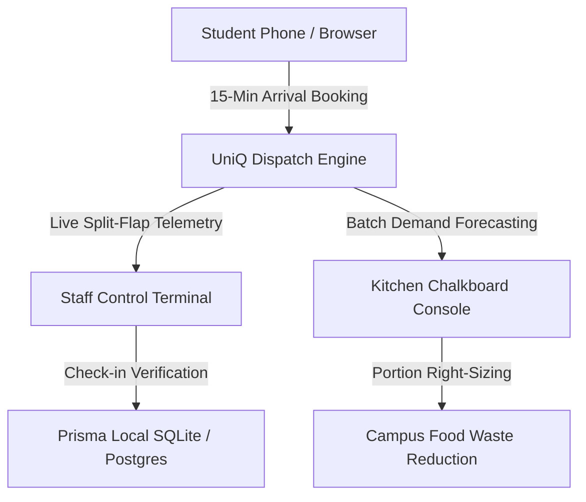

# UniQ: Mess ki line ab online! 🍛⚡
> **Next.js 14+ App Router • Prisma ORM • Three.js 3D Thali • Framer Motion • Tailwind CSS • TypeScript**
> **Signature Neo-Brutalist Dhaba Theme — Cream #F4ECD8, Ink #14110F & Saffron #F28C1B**

Built specifically for collegiate dining halls (configured for Lovely Professional University, Phagwara • 19 Messes multi-mess architecture). Engineered around real-world campus constraints (patchy Wi-Fi/4G, busy non-tech-savvy mess staff, walk-in students, and zero special hardware).

---

## 🏷️ Why UniQ?
- **University + Queue = UniQ**: A direct, memorable identity connecting higher education campus life with the daily reality of hostel dining lines.
- **The "Q" Thali Mark**: The custom wordmark features a matte black thali plate circle with a refined thin brass rim, a central saffron dot, and a short brass queue "tail" resting seamlessly on the Bebas Neue baseline.



---

## 🎨 Design System & Visual Identity
- **Cream Paper & Ink**: `--color-bg: #F4ECD8`, `--color-ink: #14110F` with night mess warm charcoal `#1A1613` toggle.
- **Bebas Neue Display Typography**: Condensed brutalist headlines paired with Fraunces italic editorial accents and IBM Plex Mono live telemetry.
- **Interactive 3D Thali**: Procedural Three.js matte black dish with brushed brass accents, 6 authentic katoris, basmati rice, rotis, and interactive hover tooltips.

---

## 🏗️ Architecture & Component Hierarchy

```
c:/UniQ App/
├── app/
│   ├── layout.tsx             # Fonts (Outfit, Inter, JetBrains Mono), Mesh BG, PWA
│   ├── globals.css            # Midnight Canteen theme variables, glass utilities
│   ├── page.tsx               # Landing page (renders MessLineHero)
│   ├── student/page.tsx       # Student Express (Heat strip, portion cards, 3D ticket)
│   ├── staff/page.tsx         # Staff Control Deck (Giant buttons, visual line, toasts)
│   ├── kitchen/page.tsx       # Kitchen & Waste (Bento forecast, 30s logger, reports)
│   ├── impact/page.tsx        # Impact Model (Sliders, before/after cards, pilot plan)
│   ├── admin/page.tsx         # Admin Settings (Live gauge preview, simulate rush)
│   ├── login/page.tsx         # 1-click evaluation profiles (Student, Staff, Kitchen)
│   └── api/                   # Route handlers (queue, bookings, forecast, waste, etc.)
├── components/
│   ├── Navbar.tsx             # Glass sticky navbar, theme toggle, mobile bottom bar
│   ├── TimeCurveChart.tsx     # Recharts area chart with saffron/amber gradients
│   ├── AttendanceChart.tsx    # Recharts predicted vs actual attendance
│   ├── home/
│   │   └── MessLineHero.tsx   # Animated mess line, flow strip, bento stats & tiles
│   └── ui/                    # Reusable Design System Components
│       ├── GlassCard.tsx      # Translucent card with inner glow & hover lift
│       ├── StatCounter.tsx    # Spring animated count-up numbers
│       ├── GaugeRing.tsx      # SVG animated circular radial progress gauge
│       ├── SlotPill.tsx       # Heat strip 15-min arrival slot with load bar
│       ├── AnimatedButton.tsx # Micro-interaction button with tap scale & glow
│       ├── FoodIcons.tsx      # Custom SVG illustrations (Thali, Steam, RiceBowl, etc.)
│       ├── Toast.tsx          # Action notifications with Undo support
│       └── Skeleton.tsx       # Shimmer loading skeleton
├── lib/
│   ├── motion.ts              # Framer Motion spring variants & transitions
│   ├── queue.ts               # Queue telemetry, service rate & drift math
│   ├── forecast.ts            # Pure TypeScript blended forecasting engine
│   ├── prisma.ts              # Singleton Prisma ORM database client
│   └── auth.ts                # Cookie session security helper
└── prisma/
    └── schema.prisma          # Database models (Student, Mess, SlotBooking, QueueEvent...)
```

---

## ⚡ Quick Start & Verification

### 1. Run the Production Server
```bash
# Starts the high-performance Next.js production server on port 3000
npm start
```
Open **`http://localhost:3000`** in your browser.

*(For local development with hot reload: `npm run dev`)*

---

## 🔑 Login & Demo Credentials

| Role | Access | Demo 1-Click Button |
|---|---|---|
| **Student** | Roll No: `22CS014` | "Demo Student (22CS014)" |
| **Mess Staff** | PIN: `1234` | "Demo Staff (1234)" |
| **Kitchen / Admin** | PIN: `5678` | "Demo Kitchen (5678)" |

---

## ⏱️ Evaluation Walkthrough

1. **Home / Hero (`http://localhost:3000/`)**:
   - Check the **headline with gradient text** and the **animated "mess line" illustration**: student dots walking along a curved track toward the steaming thali counter.
   - Note the **animated flow strip** connecting Student Staggering ➔ Queue Regulation ➔ Kitchen Optimization with traveling pulses.
   - Inspect the **Bento stats row** with live count-up numbers and radial crowd gauge.
   - Test the **Dark / Light mode toggle** in the navbar.
2. **Student Express (`http://localhost:3000/student`)**:
   - Scroll through the **horizontal heat strip** timeline of 15-min arrival slots (Quiet / Moderate / Busy) with load bars and shimmering "Best time" badge.
   - Pick a slot and choose an **illustrated portion plate** (Small, Regular, Large).
   - Click **"Confirm Slot"**: experience the **confetti burst** and inspect the **3D perforated ticket card** with the student QR code and 4-digit code.
   - Observe the **Off-Peak streak counter** (`🔥 Streak: 4 meals`).
3. **Staff Control Deck (`http://localhost:3000/staff`)**:
   - Experience the **dark high-contrast control deck**:
     - Tap **`+1 WALK-IN`**: the queue length increments with spring animation, and an action toast slides in with an **`[Undo]`** button!
     - Tap **`SERVED & EXIT`**: line advances and visual dots update.
     - Fast check-in: type the student's 4-digit code in the numeric box.
     - Manual drift correction: tap `+1 Count` or `-1 Count`.
4. **Live Rush Simulation**:
   - Click **`⚡ Simulate Rush`** in the top navigation bar from any page to pump arrivals and services into the queue live for 30 seconds!
5. **Kitchen & Waste Analytics (`http://localhost:3000/kitchen`)**:
   - Inspect the **Bento forecast hero card** with target plates count-up, confidence arc, and the automated **-6% recipe feedback note** on Rice.
   - Switch to **30s Waste Logger**: tap preset leftover chips (**1k, 2k, 5k, 10k**) per dish and enter plate return bin weight.
   - Trigger the **Surplus Food Notice** (>10kg) with NGO recipient contact field.
   - Switch to **Reports & CSV**: inspect the attendance chart, ranked wasted dishes, and download the CSV report.
6. **Impact Model (`http://localhost:3000/impact`)**:
   - Review the **Baseline vs. With System** cards labeled `SIMULATED`.
   - Drag the sliders (**Avg Food Cost**, **Plates per Day**, **Adoption %**) and watch rupee savings and waste cut percentages recalculate live with animated numbers.
   - Follow the **4-Week Collegiate Pilot Plan** roadmap.
7. **Mobile Responsiveness (375px - 414px)**:
   - On mobile screens, observe the sticky **glass bottom tab bar** with 1-tap thumb navigation and active animated indicator.

---

## 🔮 Future Scope
- **A La Carte Ordering**: Selective extra ordering (e.g. specialized canteen snacks, live egg station, or fresh fruit shakes) will be added to the student app in a future release. For now, dining is managed through fixed institutional meal plans (Standard 4-meal vs Basic 3-meal) to stabilize baseline kitchen prep.
- **Physical Sensor Integration**: ESP32 ultrasonic overhead line sensors and smart load-cell return scales for automated drift alignment.
- **Biometric Integration Testing**: Optional NFC student identity cards for automated turnstile check-in without manual PIN entry.

---

## ⚖️ Campus Integrity & Disclaimer
> **Notice**: Built as a student project for Lovely Professional University (LPU). Not an official LPU service. UniQ makes no claim of official adoption or partnership with Lovely Professional University. All capacities, queue parameters, and plate counts are explicitly marked **SIMULATED** until empirical verification with the LPU mess office.
